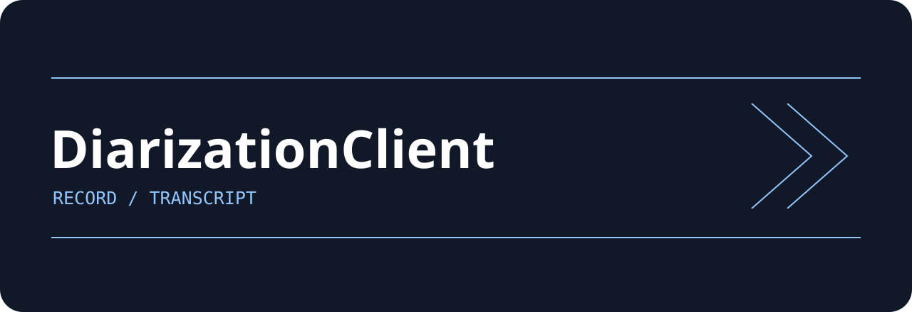

# DiarizationClient

An Android prototype for a recording and transcript interface. The current record screen uses sample text. Live transcription, speaker diarization, and connecting to a server are not implemented.

## Table of Contents

- [Build](#build)
- [Technologies](#technologies)

## Build

Open in Android Studio and sync the checked-in Gradle wrapper. The app compiles against Android SDK 35 and requires API 24 or newer. Run `./gradlew assembleDebug` on macOS/Linux or `gradlew.bat assembleDebug` on Windows.

## Technologies

- [Kotlin](https://kotlinlang.org/)
- [Android SDK](https://developer.android.com/)
- [AndroidX Navigation](https://developer.android.com/guide/navigation)
- [Gradle](https://gradle.org/)
